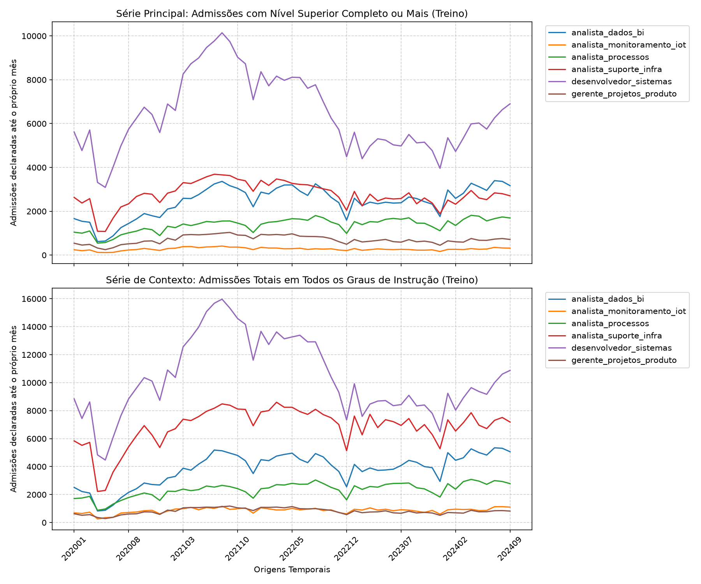
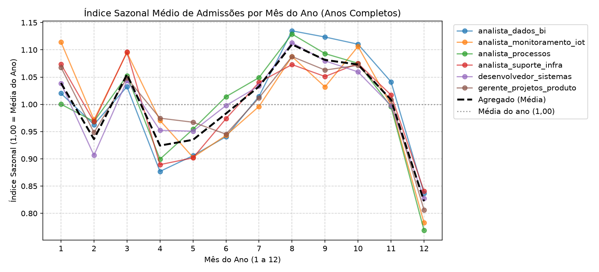

# Análise Exploratória de Dados (EDA) — Conjunto de Treino

- **Data de geração (UTC):** 2026-11-14T01:13:52Z
- **SHA-256 do Painel:** 8e653b0047ceed204d25bf7c0d9d28c8d7944bd4e75c7f65bf4ea09651b4eb9e
- **Nota metodológica:** Dados observados do Novo Caged; nenhum número deste relatório vem de validação ou teste.

Relatório descritivo automatizado sobre o conjunto de treino do Novo Caged (202001 a 202409).
Registros posteriores (embargo e validação) foram estritamente isolados e ignorados:
- Linhas de painel desconsideradas: 1.944
- Linhas pré-agregadas desconsideradas (> 202412): 5.786

---

## 1. Qualidade e cobertura

| Indicador | Valor |
|---|---|
| Linhas brutas lidas nos arquivos Parquet | 6.925.532 |
| Linhas descartadas com código de UF inválido | UF 99: 2.264 |
| Linhas descartadas por competência posterior | 865.842 |
| Linhas do painel no treino (t ≤ 202409) | 9.234 |
| Linhas posteriores ignoradas na montagem da EDA | 1.944 |
| Total de origens mensais de treino analisadas | 57 |
| Origens de treino com todas as features | 45 (202101 a 202409) |
| Registros com alvo consolidado ausente | 0 |
| Proporção de células com zero nas admissões | 14,18% |

*Fonte: Novo Caged, MTE/PDET | População: admissões formais, ocupações CBO do destino | Natureza: observado* | Unidade: contagens e percentuais | Período: 202001–202409

### Ausência de Dados por Coluna de Feature (Treino)

| Coluna de Feature | Linhas Ausentes | Proporção Ausente (%) |
|---|---|---|
| mes | 0 | 0,00% |
| admissoes | 0 | 0,00% |
| desligamentos | 0 | 0,00% |
| admissoes_lag_1 | 162 | 1,75% |
| admissoes_lag_2 | 324 | 3,51% |
| admissoes_lag_3 | 486 | 5,26% |
| admissoes_lag_12 | 1.944 | 21,05% |
| desligamentos_lag_1 | 162 | 1,75% |
| desligamentos_lag_2 | 324 | 3,51% |
| desligamentos_lag_3 | 486 | 5,26% |
| desligamentos_lag_12 | 1.944 | 21,05% |
| admissoes_soma_3m | 324 | 3,51% |
| admissoes_media_3m | 324 | 3,51% |
| admissoes_sazonal_ano_anterior | 1.782 | 19,30% |
| admissoes_total | 0 | 0,00% |
| desligamentos_total | 0 | 0,00% |
| admissoes_total_lag_1 | 162 | 1,75% |
| admissoes_total_lag_2 | 324 | 3,51% |
| admissoes_total_lag_3 | 486 | 5,26% |
| admissoes_total_lag_12 | 1.944 | 21,05% |
| desligamentos_total_lag_1 | 162 | 1,75% |
| desligamentos_total_lag_2 | 324 | 3,51% |
| desligamentos_total_lag_3 | 486 | 5,26% |
| desligamentos_total_lag_12 | 1.944 | 21,05% |
| admissoes_total_soma_3m | 324 | 3,51% |
| admissoes_total_media_3m | 324 | 3,51% |
| admissoes_total_sazonal_ano_anterior | 1.782 | 19,30% |

*Fonte: Novo Caged, MTE/PDET | População: admissões formais, ocupações CBO do destino | Natureza: observado* | Unidade: contagens e percentuais | Período: 202001–202409

> **Fato observado:** No período de treino estrito (202001 a 202409), foram analisadas 57 origens temporais com 9.234 registros, sendo que 45 origens possuem todas as features presentes (202101 a 202409) e a taxa global de zeros foi de 14,18%.

---

## 2. Densidade (D04a)

| Destino | UFs Elegíveis (Média ≥ 10) | Cobertura de Admissões (%) | UFs Excluídas (< 10 ou sem dados) |
|---|---|---|---|
| analista_dados_bi | 21 / 27 | 99,69% | 11, 12, 14, 16, 17, 28 |
| analista_monitoramento_iot | 14 / 27 | 96,18% | 11, 12, 14, 16, 17, 21, 22, 24, 25, 27, 28, 50, 51 |
| analista_processos | 20 / 27 | 99,13% | 11, 12, 14, 16, 17, 22, 28 |
| analista_suporte_infra | 24 / 27 | 99,81% | 12, 14, 16 |
| desenvolvedor_sistemas | 23 / 27 | 99,91% | 11, 12, 14, 16 |
| gerente_projetos_produto | 13 / 27 | 98,12% | 11, 12, 14, 15, 16, 17, 21, 22, 24, 25, 27, 28, 50, 51 |

*Fonte: Novo Caged, MTE/PDET | População: admissões formais, ocupações CBO do destino | Natureza: observado* | Unidade: UFs e percentual | Período: 202001–202409

> **Fato observado:** Do total de 162 séries destino × UF analisadas no treino, 115 atenderam ao critério de densidade mínima de 10 admissões/tri (D04a) e 47 foram excluídas, atingindo cobertura de 99,61% das admissões observadas no treino.

---

## 3. Nível e tendência

| Destino | Consolidado (Superior) | Média Mensal (Superior) | Dif. vs As-Of (Superior) | Consolidado (Total) | Média Mensal (Total) | Dif. vs As-Of (Total) |
|---|---|---|---|---|---|---|
| analista_dados_bi | 140.723 | 2.468,8 | 0,82% | 221.287 | 3.882,2 | 1,03% |
| analista_monitoramento_iot | 15.933 | 279,5 | 1,18% | 50.073 | 878,5 | 1,55% |
| analista_processos | 79.769 | 1.399,5 | 0,83% | 135.676 | 2.380,3 | 1,00% |
| analista_suporte_infra | 159.611 | 2.800,2 | 1,17% | 397.451 | 6.972,8 | 1,75% |
| desenvolvedor_sistemas | 369.168 | 6.476,6 | 0,84% | 596.058 | 10.457,2 | 1,09% |
| gerente_projetos_produto | 40.479 | 710,2 | 0,88% | 46.647 | 818,4 | 1,07% |

*Fonte: Novo Caged, MTE/PDET | População: admissões formais, ocupações CBO do destino | Natureza: observado* | Unidade: admissões formais consolidadas e percentual | Período: 202001–202409

> **Fato observado:** O destino com maior volume consolidado com nível superior no treino foi 'desenvolvedor_sistemas', totalizando 369.168 admissões observadas.

---

## 4. Sazonalidade

| Destino | Jan | Fev | Mar | Abr | Mai | Jun | Jul | Ago | Set | Out | Nov | Dez |
|---|---|---|---|---|---|---|---|---|---|---|---|---|
| analista_dados_bi | 1,02 | 0,96 | 1,03 | 0,88 | 0,91 | 0,94 | 1,01 | 1,13 | 1,12 | 1,11 | 1,04 | 0,84 |
| analista_monitoramento_iot | 1,11 | 0,97 | 1,09 | 0,97 | 0,90 | 0,94 | 1,00 | 1,09 | 1,03 | 1,11 | 1,00 | 0,78 |
| analista_processos | 1,00 | 0,97 | 1,05 | 0,90 | 0,95 | 1,01 | 1,05 | 1,13 | 1,09 | 1,08 | 1,00 | 0,77 |
| analista_suporte_infra | 1,07 | 0,97 | 1,10 | 0,89 | 0,90 | 0,97 | 1,04 | 1,07 | 1,05 | 1,08 | 1,02 | 0,84 |
| desenvolvedor_sistemas | 1,04 | 0,91 | 1,04 | 0,95 | 0,95 | 1,00 | 1,03 | 1,11 | 1,08 | 1,06 | 1,00 | 0,83 |
| gerente_projetos_produto | 1,07 | 0,95 | 1,05 | 0,97 | 0,97 | 0,95 | 1,01 | 1,09 | 1,06 | 1,07 | 1,01 | 0,81 |
| **Agregado** | 1,04 | 0,94 | 1,05 | 0,92 | 0,93 | 0,98 | 1,03 | 1,11 | 1,08 | 1,07 | 1,01 | 0,82 |

*Fonte: Novo Caged, MTE/PDET | População: admissões formais, ocupações CBO do destino | Natureza: observado* | Unidade: índice sazonal (1,00 = média anual) | Anos completos considerados: 2020, 2021, 2022, 2023

> **Fato observado:** Com base exclusivamente nos anos completos do treino (2020, 2021, 2022, 2023), o padrão sazonal do agregado atingiu o maior índice no mês 8 (1,11) e o menor índice no mês 12 (0,82).

---

## 5. 2020 × demais anos

### Série Principal: Nível Superior Completo ou Mais

| Ano | Meses no Treino | Admissões Consolidadas | Média Mensal | CV Mensal | Dif. vs As-Of (%) | Fração FOR (%) | Declaradas após o Mês (%) |
|---|---|---|---|---|---|---|---|
| 2020 | 12 | 127.644 | 10.637,0 | 0,251 | 2,09% | 2,48% | 2,33% |
| 2021 | 12 | 210.736 | 17.561,3 | 0,121 | 1,13% | 1,31% | 1,31% |
| 2022 | 12 | 190.921 | 15.910,1 | 0,150 | 0,66% | 0,75% | 0,75% |
| 2023 | 12 | 147.855 | 12.321,2 | 0,095 | 0,44% | 0,49% | 0,49% |
| 2024 | 9 | 128.527 | 14.280,8 | 0,089 | 0,31% | 0,38% | 0,38% |

*Fonte: Novo Caged, MTE/PDET | População: admissões formais, ocupações CBO do destino | Natureza: observado* | Unidade: contagens, razões e percentuais | Período: 202001–202409

### Série de Contexto: Total de Ocupações (Todos os Graus de Instrução)

| Ano | Meses no Treino | Admissões Consolidadas | Média Mensal | CV Mensal | Dif. vs As-Of (%) | Fração FOR (%) | Declaradas após o Mês (%) |
|---|---|---|---|---|---|---|---|
| 2020 | 12 | 220.045 | 18.337,1 | 0,274 | 3,04% | 3,41% | 3,28% |
| 2021 | 12 | 364.224 | 30.352,0 | 0,116 | 1,72% | 1,91% | 1,91% |
| 2022 | 12 | 344.735 | 28.727,9 | 0,144 | 0,80% | 0,92% | 0,92% |
| 2023 | 12 | 280.318 | 23.359,8 | 0,096 | 0,59% | 0,69% | 0,69% |
| 2024 | 9 | 237.870 | 26.430,0 | 0,065 | 0,46% | 0,57% | 0,57% |

*Fonte: Novo Caged, MTE/PDET | População: admissões formais, ocupações CBO do destino | Natureza: observado* | Unidade: contagens, razões e percentuais | Período: 202001–202409

> **Fato observado:** O ano de 2020 apresentou coeficiente de variação mensal de 0,251 e média mensal consolidada de 10.637,0 admissões na série principal (12 meses com movimentação no treino).

---

## 6. Defasagem de declaração (R02)

### Série Principal: Nível Superior Completo ou Mais

| Ano Movimentação | Até 0m (%) | Até 1m (%) | Até 2m (%) | Até 3m (%) | Até 6m (%) | Até 12m (%) | Fração Exclusões (%) |
|---|---|---|---|---|---|---|---|
| 2020 | 97,7% | 98,7% | 99,1% | 99,3% | 99,7% | 100,0% | 0,30% |
| 2021 | 98,7% | 99,3% | 99,5% | 99,7% | 99,9% | 100,0% | 0,19% |
| 2022 | 99,2% | 99,7% | 99,9% | 99,9% | 100,0% | 100,0% | 0,09% |
| 2023 | 99,5% | 99,8% | 99,9% | 99,9% | 99,9% | 100,0% | 0,05% |
| 2024 | 99,7% | 99,9% | 99,9% | 99,9% | 100,0% | 100,0% | 0,07% |

*Fonte: Novo Caged, MTE/PDET | População: admissões formais, ocupações CBO do destino | Natureza: observado* | Unidade: percentual acumulado (%) | Período: 202001–202412

### Série de Contexto: Total de Ocupações (Todos os Graus de Instrução)

| Ano Movimentação | Até 0m (%) | Até 1m (%) | Até 2m (%) | Até 3m (%) | Até 6m (%) | Até 12m (%) | Fração Exclusões (%) |
|---|---|---|---|---|---|---|---|
| 2020 | 96,7% | 98,0% | 98,6% | 98,9% | 99,4% | 100,0% | 0,34% |
| 2021 | 98,1% | 98,8% | 99,2% | 99,4% | 99,8% | 100,0% | 0,22% |
| 2022 | 99,1% | 99,6% | 99,8% | 99,8% | 99,9% | 100,0% | 0,12% |
| 2023 | 99,3% | 99,7% | 99,8% | 99,8% | 99,9% | 100,0% | 0,10% |
| 2024 | 99,5% | 99,7% | 99,8% | 99,8% | 99,9% | 100,0% | 0,12% |

*Fonte: Novo Caged, MTE/PDET | População: admissões formais, ocupações CBO do destino | Natureza: observado* | Unidade: percentual acumulado (%) | Período: 202001–202412

> **Fato observado:** Na série principal, em média, 99,0% das admissões foram declaradas no próprio mês (até 0 meses), atingindo 99,7% em até 3 meses, com fração média de exclusões de 0,14%.

---

## 7. Distribuição do alvo

| Destino | N | Zeros (%) | Média | Desvio | Q10 | Q25 | Mediana (Q50) | Q75 | Q90 |
|---|---|---|---|---|---|---|---|---|---|
| analista_dados_bi | 1.539 | 3,1% | 279,2 | 870,4 | 2,0 | 9,0 | 35,0 | 149,5 | 510,2 |
| analista_monitoramento_iot | 1.539 | 15,1% | 31,2 | 74,3 | 0,0 | 2,0 | 9,0 | 23,0 | 74,2 |
| analista_processos | 1.539 | 2,8% | 157,2 | 348,6 | 3,0 | 10,0 | 46,0 | 129,5 | 395,0 |
| analista_suporte_infra | 1.539 | 0,0% | 310,8 | 796,2 | 7,8 | 22,0 | 70,0 | 291,0 | 594,4 |
| desenvolvedor_sistemas | 1.539 | 1,0% | 721,9 | 2.130,3 | 5,0 | 23,0 | 94,0 | 573,5 | 1.234,2 |
| gerente_projetos_produto | 1.539 | 12,0% | 79,4 | 250,1 | 0,0 | 2,0 | 9,0 | 51,5 | 134,2 |

*Fonte: Novo Caged, MTE/PDET | População: admissões formais, ocupações CBO do destino | Natureza: observado* | Unidade: admissões formais observadas no grupo e território (soma dos 3 meses seguintes) | Período: 202001–202409

> **Fato observado:** A distribuição do alvo trimestral consolidado apresenta proporção global de zeros de 5,66% para o conjunto de séries de treino avaliadas.
