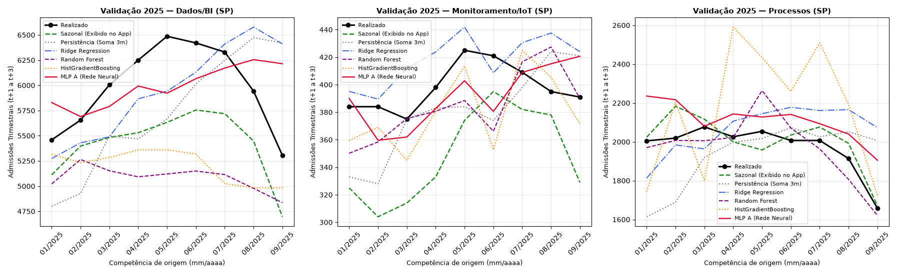
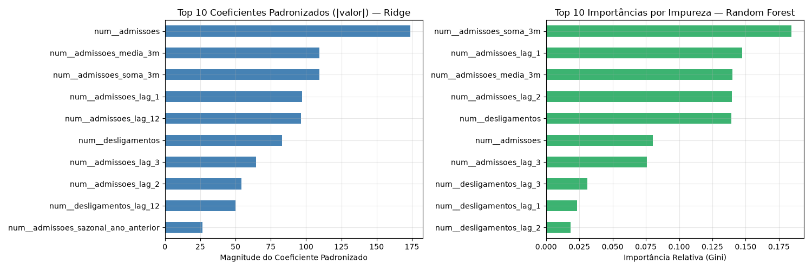

# Previsão de Demanda de Admissões Formais no Mercado de Tecnologia
## Projeto CitizenTech — Machine Learning & Modelling (GS 2026.2)

**Integrantes (nome completo + RM):** Guilherme Orugian — RM572882; Lucas Henrique — RM571901; Rodrigo Bettio — RM573725.

- **Problema:** Apoio à transição de carreira para profissionais graduados por meio de estimativas de admissões formais.
- **Público:** Profissionais com ensino superior completo em processo de transição ou requalificação para tecnologia.
- **Fonte Oficial:** Microdados do Novo Caged (Ministério do Trabalho e Emprego — MTE).
- **Alvo:** Admissões formais acumuladas no trimestre móvel seguinte (t+1 a t+3) por destino profissional e UF.

<div class="quebra-pagina"></div>

# Problema e Público

- **Contexto da Transição de Carreira:**
  - Profissionais com ensino superior enfrentam incertezas ao migrar para a área tecnológica.
  - Os microdados públicos existem, mas não chegam ao profissional em formato comparável por ocupação e território.
- **Definição Operacional do Problema:**
  - Estimar o volume de admissões formais com superior completo no trimestre seguinte (A(t+1) + A(t+2) + A(t+3)).
  - Recorte em 3 grupos ocupacionais de destino (CBO) × 27 Unidades da Federação.
- **Público-Alvo:**
  - Pessoas graduadas em transição de carreira que buscam direcionamento informado por dados.
  - Usuários que necessitam de contexto territorial realista sobre movimentações formais do mercado de trabalho.

<div class="quebra-pagina"></div>

# Motivação

- **Assimetria de Informação:**
  - Sem um indicador comparável, a escolha tende a se apoiar em percepções gerais sobre o mercado (premissa do projeto, não medida aqui).
  - Falta de ferramentas que traduzam registros administrativos públicos em indicadores analíticos acessíveis.
- **Transparência e Honestidade Metodológica:**
  - Evitar promessas infundadas ou abordagens deterministas.
  - Oferecer uma métrica observável de fluxo no emprego formal para balizar o planejamento de estudos e transição.
- **Impacto Social:**
  - Objetivo (não medido nesta entrega): dar contexto territorial de admissões formais para apoiar o planejamento da transição.

<div class="quebra-pagina"></div>

# Base de Dados

- **Origem dos Dados:**
  - Microdados administrativos do Novo Caged (MTE), abrangendo admissões e desligamentos formais com nível superior.
- **Recorte MVP (R29):**
  - Três grupos de ocupações tecnológicas: `analista_dados_bi`, `analista_monitoramento_iot` e `analista_processos`.
  - 27 UFs brasileiras, gerando 81 séries temporais mensais de 202001 a 202509 (5.589 observações no painel).
- **Critério de Densidade (D04a):**
  - Média mínima de 10 admissões no alvo durante o período de treino.
  - 55 séries elegíveis (26 séries excluídas por baixa densidade); 495 observações no conjunto de validação externa.
- **Governança Temporal (D10):**
  - Histórico 2020 reservado exclusivamente para lags; fit de 202101 a 202409; embargo de 202410 a 202412; validação de 202501 a 202509; holdout 2026 estritamente fechado.

<div class="quebra-pagina"></div>

# Arquitetura Simplificada

```
[Microdados Novo Caged / MTE] (FTP Público Mensal)
             │
             ▼
[Módulo de Ingestão & Recorte MVP] (Filtro CBO TI + Superior Completo)
             │
             ▼
[Painel Mensal de Features] (Lags 1, 2, 3, 12 + Janelas Móveis + Alvo t+1..t+3)
             │
             ▼
[Camada de Modelagem]
  ├── Baselines de Referência (Persistência e Sazonal Ano Anterior)
  ├── Modelos Clássicos (Ridge, Random Forest, HistGradientBoosting)
  └── Rede Neural Artificial (MLP PyTorch [64, 32])
             │
             ▼
[Exportador de Snapshot Integrado] (citizentech_ml.mercado.exportar)
             │
             ▼
[API FastAPI & Painel Técnico R06] (`GET /mercado/{destino}/modelos`)
```

<div class="quebra-pagina"></div>

# Modelos Comparados

- **Baselines Heurísticos de Referência:**
  - *Persistência:* replica a soma de admissões dos 3 meses mais recentes (`admissoes_soma_3m`).
  - *Sazonal:* replica as admissões do mesmo trimestre no ano anterior (`admissoes_sazonal_ano_anterior`).
- **Modelos Clássicos de Machine Learning:**
  - *Ridge Regression:* modelo linear com regularização L2 para controle de multicolinearidade entre lags temporais.
  - *Random Forest Regressor:* ensemble de árvores de decisão capaz de capturar não-linearidades e interações entre UFs e ocupações.
  - *HistGradientBoosting Regressor:* boosting baseado em histogramas para modelagem rápida e robusta a dispersões.
- **Referência Neural:**
  - *Multi-Layer Perceptron (MLP):* arquitetura com 2 camadas ocultas [64, 32], regularização via Dropout e Early Stopping.

<div class="quebra-pagina"></div>

# Otimização e Hiperparâmetros

- **Protocolo de Validação Cruzada:**
  - `RandomizedSearchCV` temporal com 3 folds expandidos e embargo temporal de 3 meses entre treino e teste de cada fold.
  - Prevenção rigorosa contra vazamento temporal (data leakage): imputação mediana e padronização calculadas estritamente dentro de cada fold.
- **Hiperparâmetros Selecionados pelo CV:**
  - *Ridge:* α = 100,0 (forte regularização L2 necessária pela alta correlação entre lags).
  - *Random Forest:* `n_estimators = 100`, `max_depth = 12`, `min_samples_leaf = 3`.
  - *HistGradientBoosting:* `max_leaf_nodes = 15`, `learning_rate = 0,1`, `l2_regularization = 0,0`.

<div class="quebra-pagina"></div>

# Métricas de Desempenho (Validação Externa 2025)

Avaliação em 55 séries elegíveis (495 pontos temporais de 202501 a 202509):

| Modelo | MAE | RMSE | WAPE | MASE |
|---|---:|---:|---:|---:|
| **Baseline Persistência** | 35,45 | 103,58 | 12,56% | 0,798 |
| **Baseline Sazonal** | **33,60** | 91,38 | **11,90%** | 0,833 |
| **Ridge Regression** | 34,26 | **84,42** | 12,14% | 1,220 |
| **Random Forest** | 35,63 | 135,60 | 12,62% | **0,726** |
| **HistGradientBoosting** | 39,74 | 132,10 | 14,08% | 0,770 |
| *MLP A (Referência RNA)* | *31,65* | *73,67* | *11,21%* | *1,136* |



*Constatação central:* Nenhum modelo clássico superou o Baseline Sazonal em MAE. A MLP apresentou o menor erro (−5,78% vs sazonal).

<div class="quebra-pagina"></div>

# Importância das Variáveis

- **Comportamento das Variáveis Preditivas:**
  - Dominância expressiva das variáveis autorregressivas recentes: no Random Forest, destacam-se `admissoes_soma_3m` (0,1845), `admissoes_lag_1` (0,1472), `admissoes_media_3m` (0,1400), `admissoes_lag_2` (0,1398) e `desligamentos` (0,1394).
  - No Ridge, os maiores coeficientes padronizados absolutos são `admissoes` (174,03), `admissoes_media_3m` (109,43) e `admissoes_soma_3m` (109,43).
  - A feature `admissoes_sazonal_ano_anterior` tem importância residual no Random Forest (0,0008); totais nacionais não são incluídos no rol de preditores numéricos do modelo.
- **Leitura Metodológica Crítica:**
  - As variáveis refletem forte inércia estrutural do emprego formal nas ocupações de tecnologia.
  - As relações identificadas são de caráter estritamente preditivo estatístico, não configurando inferência de causalidade econômica.
- **Visualização das Importâncias:**
  - Gráfico abaixo (gerado pelo notebook a partir dos artefatos).



<div class="quebra-pagina"></div>

# Modelo Final e Decisão Honesta de Promoção

- **Regra de Decisão do Projeto (D10a):**
  - Um modelo é promovido ao número mostrado ao usuário só se o MAE de validação ficar ≥ 5% abaixo do melhor baseline E o desvio do WAPE entre folds for menor que o ganho; a decisão final depende da avaliação no holdout 2026, que está fechado.
- **Diagnóstico Transparente:**
  - Os modelos clássicos não superaram o Baseline Sazonal (MAE 33,60 vs Ridge 34,26 e RF 35,63).
  - A MLP obteve MAE 31,65 na validação 2025 (−5,78% vs sazonal), atendendo isoladamente apenas à 1ª condição; isso não configura promoção, exigindo a verificação completa de estabilidade e o teste no holdout fechado de 2026.
- **Decisão Operacional:**
  - O aplicativo em produção expõe as estimativas do **Baseline Sazonal** por integridade metodológica e governança.
  - A **MLP A** permanece como modelo candidato em observação técnica no painel técnico R06.

<div class="quebra-pagina"></div>

# Demonstração da Aplicação Prática

- **Exemplo Real no Estado de São Paulo (Origem 202509):**
  - `analista_dados_bi` (SP): mês atual = 1.994; persistência (soma 3m) = 6.419; sazonal = 4.696; Ridge = 6.412,2; RF = 4.835,9; HGB = 4.983,3; MLP = 6.214,6; realizado = 5.305.
  - `analista_monitoramento_iot` (SP): mês atual = 121; persistência (soma 3m) = 421; sazonal = 329; Ridge = 424,0; RF = 390,0; HGB = 371,5; MLP = 420,6; realizado = 391.
  - `analista_processos` (SP): mês atual = 645; persistência (soma 3m) = 2.006; sazonal = 1.672; Ridge = 2.073,2; RF = 1.621,0; HGB = 1.723,2; MLP = 1.905,1; realizado = 1.658.
- **Como o Usuário Utiliza a Informação:**
  - O profissional em transição consulta as admissões estimadas no seu estado e ocupação como indicativo de dinamismo territorial.
  - As estimativas servem como métrica contextual de orientação, e não como veredito ou garantia individual de contratação.

<div class="quebra-pagina"></div>

# Alinhamento aos Objetivos de Desenvolvimento Sustentável (ODS)

- **ODS 4 — Educação de Qualidade (Meta 4.4):**
  - Aumentar substancialmente o número de jovens e adultos com competências técnicas e profissionais relevantes para emprego e trabalho decente.
  - A ferramenta direciona o esforço formativo para áreas de tecnologia com demanda formal mensurável.
- **ODS 8 — Trabalho Decente e Crescimento Econômico (Metas 8.5 e 8.6):**
  - Alcançar emprego pleno e produtivo para mulheres e homens, reduzindo a proporção de jovens e adultos sem ocupação ou formação.
  - Proporciona transparência de mercado para apoiar trajetórias de requalificação produtiva.
- **ODS 10 — Redução das Desigualdades:**
  - Democratização do acesso à inteligência analítica de dados do mercado de trabalho formal, historicamente restrita a grandes consultorias.
