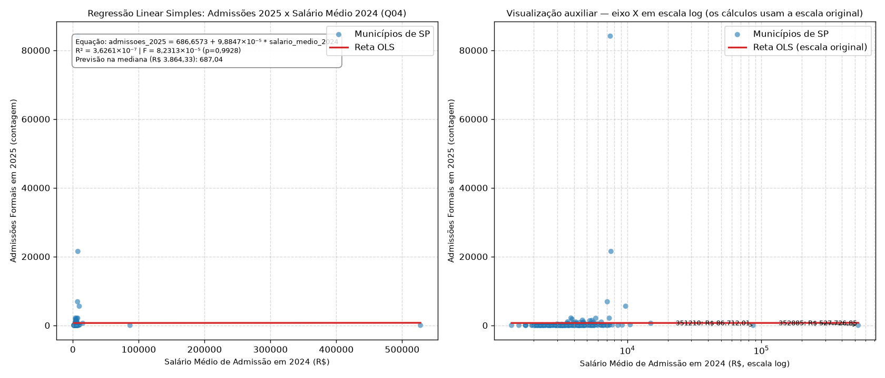
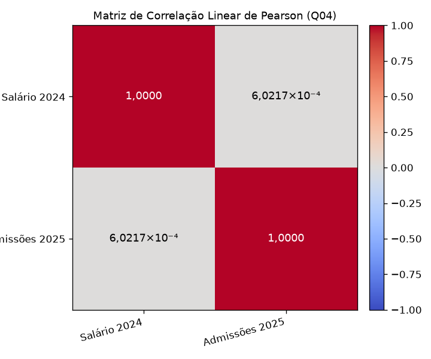
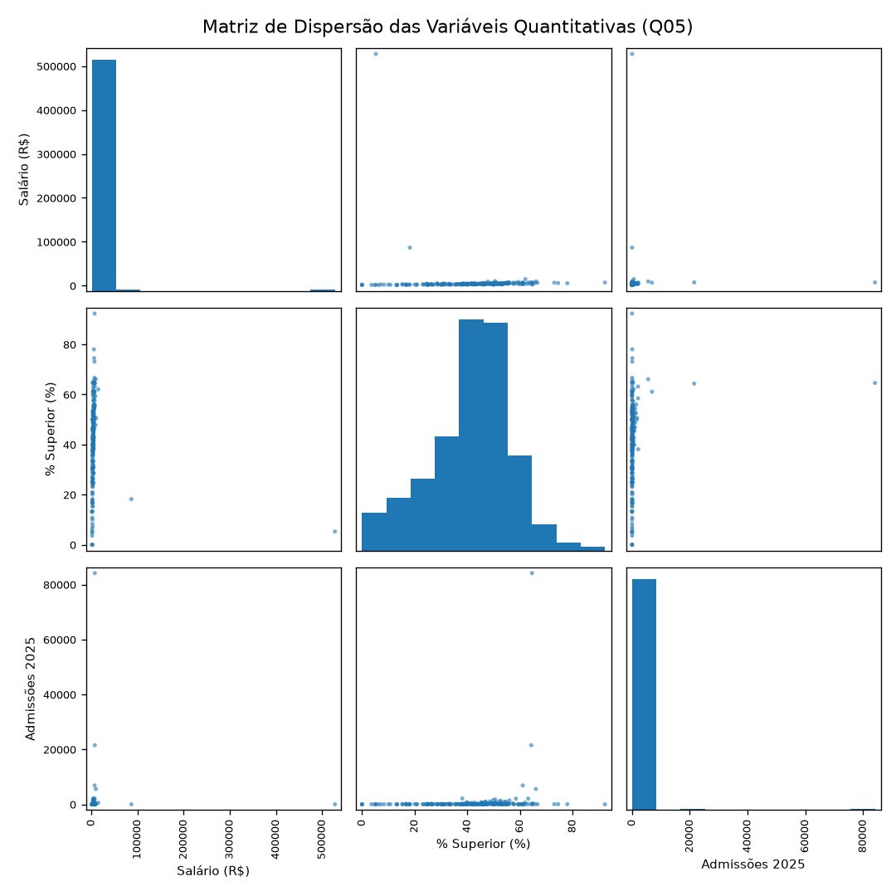
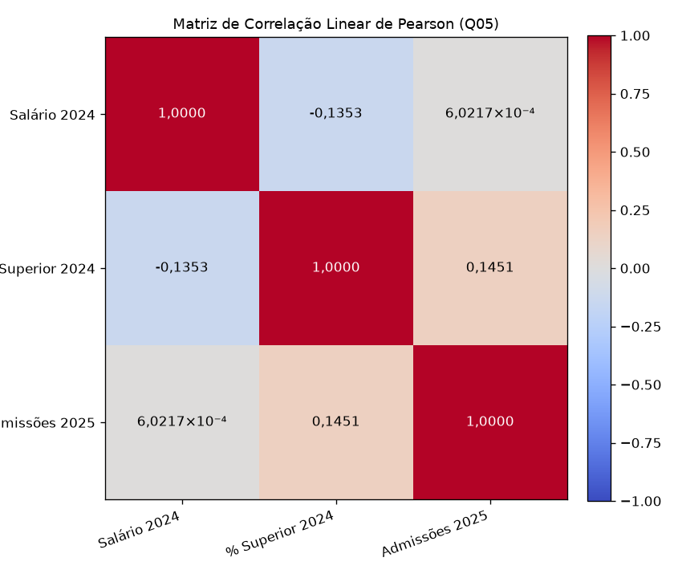
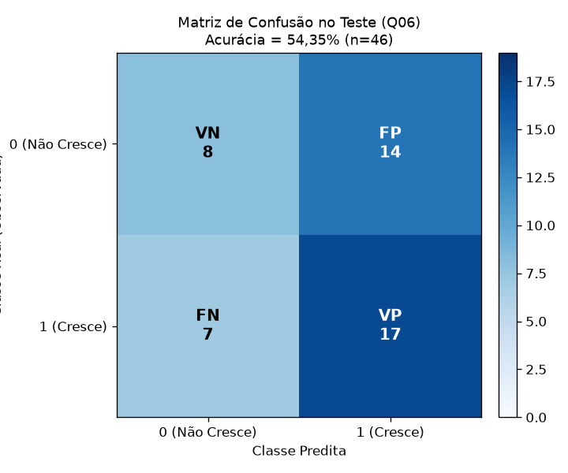
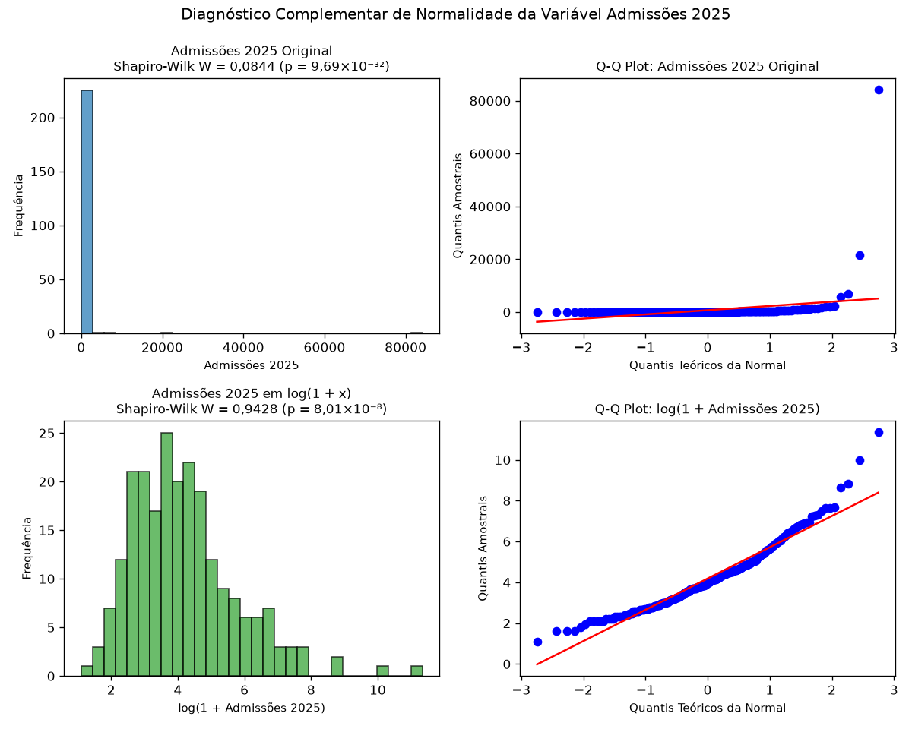
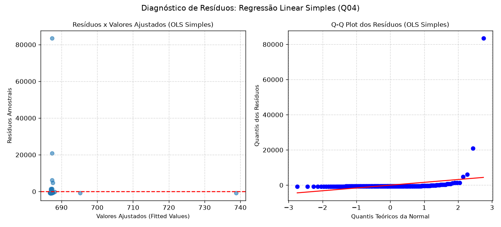
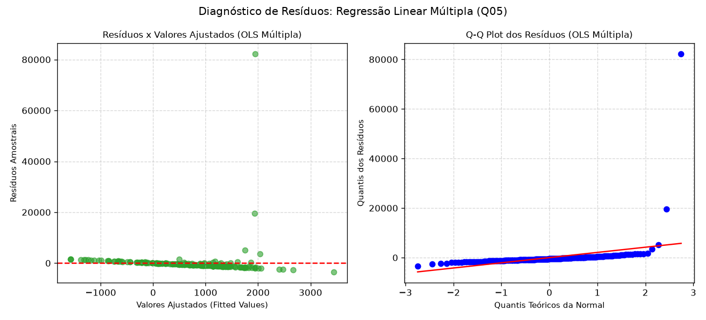

# Relatório Estatístico — Análise Territorial de Admissões Formais no Estado de São Paulo

**Integrantes (nome completo + RM):** Guilherme Orugian — RM572882; Lucas Henrique — RM571901; Rodrigo Bettio — RM573725.

---

## 1. Problema e Pergunta de Negócio

No âmbito do desafio CitizenTech, profissionais com formação superior que planejam ou executam transição de carreira técnica (em ocupações analíticas, de tecnologia da informação e correlatas) defrontam-se frequentemente com assimetrias de informação ao avaliar diferentes municípios do Estado de São Paulo. Este relatório usa registros administrativos públicos para examinar, de forma auditável, se salário e escolaridade de admissão se associam ao volume municipal de admissões formais.

O objetivo técnico deste trabalho é investigar como o volume municipal de admissões formais acumuladas em seis grupos ocupacionais selecionados se relaciona com os níveis salariais médios de admissão e com o grau de escolaridade superior dos profissionais admitidos nos municípios paulistas.

A pergunta de negócio central é: **o salário médio de admissão e a proporção de contratados com formação superior em 2024 fornecem capacidade preditiva e explicativa robusta sobre o volume e a expansão das admissões formais municipais em 2025?**

Ressalta-se, desde já, o rigor e a ética desta avaliação: os dados e modelos aqui desenvolvidos descrevem agregados territoriais de admissão e não estimam probabilidade individual de colocação no mercado de trabalho, tampouco constituem recomendações subjetivas sobre escolhas individuais.

<div class="quebra-pagina"></div>

---

## 2. Base de Dados e Governança

### 2.1 Fonte, Coleta e Pré-Registro
Os dados provêm dos microdados públicos oficiais do **Novo Caged** (Ministério do Trabalho e Emprego — MTE), cobrindo o Estado de São Paulo (código UF 35). A base foi consolidada a partir de registros mensais de movimentações por competência entre 2024 e 2025 (competências 202401 a 202412 e 202501 a 202512), sem a utilização de dados posteriores a 2025.

O recorte analítico contemplou seis grupos ocupacionais da Classificação Brasileira de Ocupações (CBO) com aderência direta a transições técnicas e de tecnologia, agregando todas as faixas de escolaridade declaradas. A população de interesse foi pré-registrada e congelada: municípios do Estado de São Paulo com pelo menos 10 admissões formais no recorte ocupacional ao longo de 2024. O arquivo de entrada é a base consolidada oficial e única deste estudo:

- **Arquivo:** `base_municipal.csv`
- **Hash criptográfico (SHA-256):** `5dbc73acfb01012a7aa0fa45ef457a7226639a8b48bda85b0389972f99a9a7ee`
- **População total:** N = 229 municípios paulistas (casos completos, 100% de preenchimento).
- **Sem truncamento artificial:** Não houve exclusão arbitrária de municípios atípicos (outliers) nem manipulação pós-observação de dados. Todos os 229 municípios foram mantidos integralmente em todas as análises paramétricas e não paramétricas, respeitando estritamente o protocolo pré-registrado D11.

### 2.2 Dicionário de Variáveis

| Variável | Tipo | Unidade | Descrição Técnica |
|---|---|---|---|
| `municipio` | Categórico | Código IBGE | Identificador municipal de 6 dígitos no Estado de São Paulo. |
| `uf` | Categórico | Sigla / Código | Unidade Federativa ("SP" ou "35"). |
| `admissoes_2024` | Quantitativo discreto | Contagem inteira | Total de admissões formais no recorte de seis grupos ocupacionais em 2024. |
| `admissoes_2025` | Quantitativo discreto | Contagem inteira | Total de admissões formais no recorte de seis grupos ocupacionais em 2025. |
| `salario_medio_2024` | Quantitativo contínuo | R$ (nominal) | Salário médio de admissão declarado no recorte em 2024 (soma salarial / admissões com salário válido). |
| `percentual_superior_2024` | Quantitativo contínuo | % | Proporção de admissões com ensino superior completo ou pós-graduação em 2024. |
| `crescimento` | Binário | 0 ou 1 | Indicador de expansão: 1 se `admissoes_2025 > admissoes_2024`, 0 caso contrário. |

### 2.3 Adequação e Limitações Inerentes
A base é inteiramente real, extraída de registros administrativos obrigatórios de contratações regidas pela CLT. Entre as limitações metodológicas inerentes, destacam-se:
1. **Recorte ocupacional específico:** Os valores não refletem o total do emprego municipal, limitando-se aos seis grupos ocupacionais selecionados.
2. **Trabalho formal exclusivamente:** A base não capta contratos de prestação de serviços como pessoa jurídica (PJ), cooperados ou trabalho informal.
3. **Perspectiva territorial municipal:** A unidade de observação é o município onde ocorreu o vínculo formal, não refletindo diretamente o perfil individual dos profissionais residentes.

<div class="quebra-pagina"></div>

---

## 3. Questão 02 — Distribuição Normal Assumida

Conforme diretriz didática do enunciado acadêmico, assumiu-se que a variável quantitativa de admissões municipais segue uma **Distribuição Normal de Probabilidade**. Analisou-se a variável `admissoes_2025` para a população de N = 229 municípios paulistas.

### 3.1 Parâmetros Populacionais Calculados

Sob o modelo paramétrico adotado, foram computadas a média populacional (μ), a mediana observada e o desvio padrão populacional com graus de liberdade populacionais (σ, com ddof = 0):

| Medida Estatística | Símbolo | Valor Calculado |
|---|---|---|
| População de municípios | N | 229 |
| Média populacional | μ | 687,3231 |
| Mediana observada | Mediana | 53,0000 |
| Desvio padrão populacional (ddof=0) | σ | 5.740,5799 |

### 3.2 Probabilidades e Classificação de Eventos

Utilizando a função de distribuição acumulada da Normal padrão sob os parâmetros μ = 687,3231 e σ = 5.740,5799:

- **a) Probabilidade da variável ser menor do que a média dos registros:**
  P(X < μ) = Φ((687,3231 − 687,3231) / 5.740,5799) = Φ(0) = 0,5000
  *Classificação do evento:* **Evento equiprovável** (P = 0,5000 ou 50,00%).

- **b) Probabilidade da variável ser maior do que a mediana dos registros:**
  P(X > Mediana) = 1 − Φ((53,0000 − 687,3231) / 5.740,5799) = 1 − Φ(−0,1105) = 0,543993
  *Classificação do evento:* **Evento provável** (P > 0,50, especificamente 54,40%).

### 3.3 Interpretação Técnica
Por construção matemática, em qualquer distribuição Normal contínua simétrica, a probabilidade de uma observação situar-se abaixo da média é estritamente igual a 0,5000 (evento equiprovável).

A probabilidade teórica de P(X > 53) = 0,5440 decorre de que a mediana empírica (53,00) situa-se substancialmente abaixo da média aritmética (687,32). Essa discrepância evidencia forte assimetria positiva na distribuição empírica real (a média é puxada para cima por municípios de grande porte, como a capital São Paulo). Ao projetar essa assimetria na curva Normal simétrica, a área sob a curva à direita de 53 abrange 54,40% da densidade teórica. Ressalta-se que este é um cálculo teórico decorrente da premissa assumida pelo enunciado pedagógico.

<div class="quebra-pagina"></div>

---

## 4. Questão 03 — Testes de Hipótese para a Média

Ainda sob a premissa de Normalidade assumida pelo enunciado, foram conduzidos dois testes de hipótese unilaterais para a média populacional de admissões em 2025, utilizando o **Teste Z** (amostragem sem reposição e desvio padrão populacional de referência σ_ref = 5.740,5799). As sementes pseudoaleatórias e tamanhos amostrais foram congelados no pré-registro.

### 4.1 Parâmetros e Resultados dos Testes Z

| Parâmetro / Métrica | Teste A (Unilateral à Esquerda) | Teste B (Unilateral à Direita) |
|---|---|---|
| Hipótese Nula (H₀) | μ = 687,3231 | μ = 687,3231 |
| Hipótese Alternativa (H₁) | μ < 687,3231 (menor) | μ > 687,3231 (maior) |
| Tamanho amostral (n) | 20 | 25 |
| Nível de significância (α) | 6% (0,06) | 9% (0,09) |
| Semente pseudoaleatória | 42 | 43 |
| Média amostral observada (x̄) | 102,0500 | 215,6800 |
| Desvio padrão de referência (σ) | 5.740,5799 | 5.740,5799 |
| Erro padrão (σ / √n) | 1.283,6310 | 1.148,1160 |
| Estatística de teste (Z) | **−0,4560** (−0,455951) | **−0,4108** (−0,410797) |
| Valor crítico (Z_crítico) | **−1,5548** | **+1,3408** |
| Região Crítica (Rejeição) | Z < −1,5548 | Z > 1,3408 |
| p-valor | **0,3242** (0,324213) | **0,6594** (0,659389) |
| **Decisão Estatística** | **Não rejeita H₀** | **Não rejeita H₀** |

### 4.2 Interpretação dos Resultados
- **Teste A (n=20, α=6%):** A média amostral sorteada foi de 102,05 admissões. Embora numericamente inferior a 687,32, a estatística padronizada obtida (Z = −0,4560) não alcançou a região crítica (Z < −1,5548), com p-valor de 0,3242 > 0,06. Logo, não há evidência estatística para rejeitar H₀ ao nível de significância de 6%.
- **Teste B (n=25, α=9%):** A média amostral sorteada foi de 215,68 admissões. A estatística padronizada resultou em Z = −0,4108, situando-se fora da região crítica de cauda direita (Z > 1,3408), com p-valor de 0,6594 > 0,09. Portanto, não se rejeita H₀ ao nível de significância de 9%.

A razão matemática central para a não rejeição em ambos os testes reside na magnitude extremamente elevada do desvio padrão populacional (σ = 5.740,58), que inflaciona o erro padrão da média amostral. Amostras de n = 20 e n = 25 possuem poder estatístico insuficiente para discriminar desvios na presença de altíssima heterogeneidade municipal. Em termos metodológicos, "não rejeitar H₀" não equivale a provar que a média amostral é idêntica à populacional, mas apenas que os desvios observados são plausíveis sob o acaso na hipótese paramétrica nula.

<div class="quebra-pagina"></div>

---

## 5. Questão 04 — Análise Bivariada (Regressão Linear Simples)

Investigou-se a relação bivariada entre a variável explicativa quantitativa X (`salario_medio_2024`) e a variável de resposta Y (`admissoes_2025`).

### 5.1 Gráficos da Análise Bivariada





### 5.2 Medidas de Associação Linear

| Medida Estatística | Valor Obtido | Interpretação |
|---|---|---|
| Covariância amostral (ddof=1) | 121.420,3916 | Positiva, mas em escala monetária-contagem não padronizada. |
| Correlação Linear de Pearson (r) | 0,000602 | Praticamente zero (r ≈ 0,0006), ausência de dependência linear. |

### 5.3 Modelo de Regressão Linear Simples (OLS)

Ajustou-se o modelo via Mínimos Quadrados Ordinários (OLS) com intercepto:
admissoes_2025 = 686,6573 + 0,00009885 × salario_medio_2024

Equação arredondada para 4 casas decimais:
admissoes_2025 = 686,6573 + 0,0001 × salario_medio_2024

### 5.4 Avaliação de Adequação do Modelo
- **Coeficiente de Determinação (R²):** 3,6261 × 10⁻⁷ (aproximadamente 0,000036%).
- **R² Ajustado:** −0,0044.
- **Estatística F do modelo:** F = 8,2313 × 10⁻⁵.
- **p-valor do Teste F:** p = 0,9928.

### 5.5 Previsão no Ponto
Calculou-se a previsão para o ponto central da distribuição salarial, definido pela mediana de `salario_medio_2024` (X = R$ 3.864,3313):
Ŷ = 686,6573385 + 0,0000988475 × 3864,331304 = 687,0393 admissões

### 5.6 Interpretação Técnica e Discussão Obrigatória de Pontos Extremos de Salário
O modelo linear simples revela que o salário médio municipal de admissão de 2024 não possui capacidade de prever o volume de admissões em 2025. O R² obtido indica que menos de 0,0001% da variação no número de admissões é explicada pela remuneração média. O Teste F (p = 0,9928 ≫ 0,05) atesta a total ausência de significância do ajuste linear. 

Consequentemente, a previsão na mediana salarial (Ŷ = 687,04) converge praticamente para a média incondicional populacional (687,32), demonstrando que a reta OLS é substancialmente horizontal. Municípios com altos salários médios de admissão podem apresentar tanto elevados volumes de admissão quanto volumes modestos, desfazendo a premissa ingênua de que volume de contratações caminha linearmente junto a salários mais altos.

#### Identificação e Diagnóstico dos Pontos Extremos de Salário
A inspeção transparente da base municipal e o bloco descritivo `pontos_extremos_salario` gerado pelo programa portátil identificam claramente três municípios com remunerações declaradas discrepantes em 2024:
1. **Município 352885:** Registrou 19 admissões em 2024 com salário médio declarado de R$ 527.726,85 (19 salários válidos em 2024), atingindo uma razão extraordinária de **136,56 vezes a mediana salarial municipal** (R$ 3.864,33). Em 2025, esse mesmo município registrou 12 admissões formais com salário médio de R$ 2.358,77.
2. **Município 351210:** Registrou 11 admissões em 2024 com salário médio declarado de R$ 86.712,01 (11 salários válidos em 2024), correspondendo a **22,44 vezes a mediana salarial municipal**. Em 2025, esse município registrou 8 admissões com salário médio de R$ 2.114,21.
3. **Município 350320:** Registrou 801 admissões em 2024 com salário médio de R$ 14.936,02 (800 salários válidos em 2024), correspondendo a **3,87 vezes a mediana**.
4. **Demais municípios:** Todos os demais 226 municípios da população analisada situam-se estritamente abaixo de aproximadamente R$ 15 mil.

A queda abrupta observada nos municípios 352885 e 351210 entre 2024 e 2025 (de R$ 527 mil para R$ 2,3 mil e de R$ 86 mil para R$ 2,1 mil) é fortemente compatível com a **hipótese técnica de erro de declaração ou de escala monetária** no campo `salário` do Novo Caged em 2024 (por exemplo, inclusão indevida de valores anuais, bônus corporativos pontuais ou digitação de centavos sem separador). Ressalta-se que esta é uma hipótese analítica plausível, mas não verificada individualmente junto aos declarantes.

#### Efeito Visual e Alavancagem Potencial na Regressão OLS
- **Efeito visual:** Na escala original (painel esquerdo da Figura Q04), a presença de uma observação isolada em R$ 527.726,85 expande dramaticamente o domínio do gráfico, achatando e comprimindo 99% dos municípios paulistas em uma faixa vertical imperceptível colada ao eixo Y (entre R$ 1.500 e R$ 15.000). Para assegurar a clareza e transparência analítica exigidas no projeto, a Figura Q04 inclui um painel auxiliar à direita rotulado *"Visualização auxiliar — eixo X em escala log (os cálculos usam a escala original)"*, no qual o espalhamento dos municípios e a posição dos pontos extremos tornam-se plenamente legíveis sem alterar os dados de cálculo.
- **Alavancagem potencial (leverage):** Do ponto de vista da teoria dos Mínimos Quadrados Ordinários, os municípios 352885 e 351210 constituem observações de altíssima alavancagem horizontal (valores extremos de X, com elemento diagonal da matriz de projeção h_ii próximo a 1). Como ambos os municípios registraram contagens modestas de admissão em 2025 (12 e 8 admissões, respectivamente), esses pontos operam como âncoras horizontais puxando a reta para baixo na extremidade direita do gráfico, contribuindo diretamente para a horizontalidade da reta OLS (coeficiente de 0,0001) e para o R² praticamente nulo.

#### Governança Metodológica: Pré-Registro D11 e Trabalho Futuro
A decisão técnica de manter integralmente essas observações decorre do **protocolo pré-registrado D11**, o qual proíbe terminantemente o corte ou exclusão ad hoc de outliers após a visualização dos dados e estimativas econométricas, blindando a pesquisa contra manipulações de conveniência. 

Em cumprimento estrito a essas diretrizes de integridade:
- **Uma análise de sensibilidade com a exclusão desses pontos atípicos NÃO foi realizada neste estudo**, ficando categorizada como **[TRABALHO FUTURO — ANÁLISE DE SENSIBILIDADE ROBUSTA]**.
- **Não foram estimados nem reportados coeficientes ou modelos "sem outliers"**, garantindo que nenhum número além do pré-registro oficial figure nas evidências e deliberações.

<div class="quebra-pagina"></div>

---

## 6. Questão 05 — Análise Multivariada (Regressão Linear Múltipla)

A análise foi expandida para três variáveis quantitativas: a variável resposta Y (`admissoes_2025`) e duas variáveis explicativas: X₁ (`salario_medio_2024`) e X₂ (`percentual_superior_2024`).

### 6.1 Matriz de Dispersão e Correlação





### 6.2 Matrizes Numéricas de Associação

**Matriz de Covariância Amostral (ddof=1):**

| Variável | Salário Médio 2024 | % Superior 2024 | Admissões 2025 |
|---|---|---|---|
| **Salário Médio 2024** | 1.228.361.218,1211 | −74.388,0764 | 121.420,3916 |
| **% Superior 2024** | −74.388,0764 | 245,9669 | 13.088,0251 |
| **Admissões 2025** | 121.420,3916 | 13.088,0251 | 33.098.793,7548 |

**Matriz de Correlação de Pearson:**

| Variável | Salário Médio 2024 | % Superior 2024 | Admissões 2025 |
|---|---|---|---|
| **Salário Médio 2024** | 1,0000 | −0,1353 | 0,0006 |
| **% Superior 2024** | −0,1353 | 1,0000 | 0,1451 |
| **Admissões 2025** | 0,0006 | 0,1451 | 1,0000 |

### 6.3 Modelo OLS Múltiplo

O ajuste OLS resultou nos seguintes coeficientes e equação:
- **Intercepto (β₀):** −1582,2304 (−1582,230380)
- **Coeficiente do Salário (β₁):** +0,003383 (+0,00338317)
- **Coeficiente do % Superior (β₂):** +54,233691 (+54,23369054)

Equação do modelo:
admissoes_2025 = −1582,2304 + 0,0034 × salario_medio_2024 + 54,2337 × percentual_superior_2024

### 6.4 Adequação do Modelo
- **Coeficiente de Determinação (R²):** 0,021458 (2,15%).
- **R² Ajustado:** 0,012798 (1,28%).
- **Estatística F:** F = 2,477885.
- **p-valor do Teste F:** p = 0,086198.

### 6.5 Previsão no Ponto Cenário (Medianas)
Para um município hipotético com os valores medianos de ambas as preditoras (X₁ = R$ 3.864,3313 e X₂ = 43,3333%):
Ŷ = −1582,23038 + 0,00338317 × 3864,331304 + 54,23369054 × 43,333333 = 780,9699 admissões

### 6.6 Interpretação Técnica e Efeito dos Pontos Extremos na OLS Múltipla
A inclusão do percentual de admissões com ensino superior elevou o R² de praticamente zero para 2,15%, trazendo o p-valor do teste F para 0,0862. Esse nível de significância é marginal (significativo a 10%, mas não a 5%). O coeficiente da variável de escolaridade superior (+54,23) indica que, mantido o salário fixo, cada ponto percentual adicional de admitidos com ensino superior associa-se em média a cerca de 54 admissões adicionais no município. Contudo, mais de 97,8% da variabilidade do volume municipal de admissões permanece não explicada por essas duas métricas estruturais.

No contexto multivariado, os pontos extremos de salário (município 352885, com R$ 527.726,85, e município 351210, com R$ 86.712,01) exercem impacto direto na estrutura de covariâncias: a variância amostral de `salario_medio_2024` atinge o valor colossal de 1,228 × 10⁹, gerando uma distância de Mahalanobis extrema para essas duas unidades territoriais. Apesar de X₁ possuir coeficiente positivo de +0,0034 no modelo conjunto, seu efeito prático na previsão municipal é ofuscado pela magnitude do coeficiente de escolaridade superior. 

Em consonância com o pré-registro D11, todas as 229 observações foram mantidas no modelo de regressão linear múltipla. Uma reestimação multivariada sem os pontos atípicos de remuneração **NÃO foi efetuada**, ficando expressamente rotulada como **[TRABALHO FUTURO — REGRESSÃO MULTIVARIADA ROBUSTA]**.

<div class="quebra-pagina"></div>

---

## 7. Questão 06 — Análise Multivariada (Regressão Logística Binária)

Modelou-se a probabilidade municipal de expansão formal no emprego técnico, definida pela variável indicadora binária `crescimento` (1 se `admissoes_2025 > admissoes_2024`, 0 caso contrário), utilizando estritamente as duas covariáveis explicativas autorizadas: `salario_medio_2024` e `percentual_superior_2024`.

Para evitar vazamento e avaliar poder de generalização, a população de N = 229 municípios foi dividida em conjunto de treino (80%, n = 183) e conjunto de teste (20%, n = 46) estratificados pelo alvo sob a semente pseudoaleatória congelada 44.

### 7.1 Equação da Regressão Logística

Ajustado via Máxima Verossimilhança no conjunto de treino (n=183):
- **Intercepto (β₀):** −0,649693
- **β_salario:** −0,00005504 (−5,5038e-05)
- **β_% superior:** +0,022325

Equações de especificação:
logit(p) = ln(p / (1 − p)) = −0,6497 − 0,0001 × salario_medio_2024 + 0,0223 × percentual_superior_2024

p = 1 / (1 + exp(−(−0,6497 − 0,0001 × salario_medio_2024 + 0,0223 × percentual_superior_2024)))

### 7.2 Avaliação do Modelo (Ajuste vs. Teste Fora da Amostra)

Adotou-se o limiar clássico de decisão probabilística p ≥ 0,50.



**Matriz de Confusão no Teste (n = 46, avaliação fora da amostra):**

| Real / Predito | Predito 0 (Não Cresceu) | Predito 1 (Cresceu) | Total Real |
|---|:---:|:---:|:---:|
| **Real 0 (Não Cresceu)** | **8** (VN) | **14** (FP) | 22 |
| **Real 1 (Cresceu)** | **7** (FN) | **17** (VP) | 24 |
| **Total Predito** | 15 | 31 | 46 |

**Comparativo de Desempenho:**
- **Acurácia no Ajuste (Treino, n=183, in-sample descritiva):** 53,01% (97 acertos em 183 municípios).
- **Acurácia no Teste Estratificado (n=46, out-of-sample):** **54,35%** (25 acertos em 46 municípios).

### 7.3 Classificação no Ponto de Medianas
Para o cenário municipal com os atributos medianos (X₁ = R$ 3.864,3313 e X₂ = 43,3333%):
logit(p) = −0,649693 − 0,000055038 × 3864,3313 + 0,0223255 × 43,3333 = +0,1050

p = 1 / (1 + exp(−0,1050)) = 0,526240 (52,62%)

- **Probabilidade calculada:** 52,62%
- **Decisão no limiar 0,5:** **Classe 1 (Crescimento de admissões)**.

### 7.4 Interpretação Técnica
O modelo logístico apresenta desempenho preditivo limitado (54,35% de acurácia no teste), situando-se marginalmente acima do lançamento de uma moeda equilibrada (50%). 

A análise da matriz de confusão no teste aponta uma fragilidade crítica: **elevada taxa de falsos positivos** (14 municípios em 22 que não cresceram foram incorretamente rotulados como em crescimento). Isso indica que municípios com maior proporção de ensino superior recebem probabilidades ligeiramente superiores a 50%, mas muitos deles não mantêm crescimento de contratações no ano subsequente. Portanto, o salário médio e o percentual de ensino superior de um município não constituem garantia de crescimento sustentado das contratações formais no recorte técnico.

<div class="quebra-pagina"></div>

---

## 8. Diagnóstico de Normalidade e Análise de Resíduos

Em conformidade com os princípios da boa prática econométrica, realizou-se um diagnóstico complementar de normalidade e aderência dos resíduos, destacando a discrepância entre a premissa teórica do enunciado e os dados reais observados.

### 8.1 Teste de Shapiro-Wilk para Normalidade

Avaliou-se a variável populacional `admissoes_2025` na escala original e após a transformação logarítmica ln(1 + x):

| Escala da Variável | Estatística W | p-valor | Conclusão Estatística |
|---|---|---|---|
| **Escala Original** (`admissoes_2025`) | **0,084408** | 9,6908 × 10⁻³² | Rejeição categórica da Normalidade (p ≪ 0,001). |
| **Escala Transformada** (ln(1 + x)) | **0,942802** | 8,0065 × 10⁻⁸ | Rejeição da Normalidade (p ≪ 0,001). |



Como evidenciado nos histogramas e gráficos Q-Q da figura acima, a distribuição empírica original apresenta cauda pesadíssima à direita (assimetria extrema), típica de redes urbanas onde a capital estadual e poucas metrópoles concentram ordens de grandeza a mais de movimentações formais do que os municípios de pequeno porte. Embora a transformação logarítmica suavize a escala, a hipótese de Normalidade é firmemente rejeitada em ambos os casos.

### 8.2 Análise de Resíduos dos Modelos OLS e Diagnóstico de Alavancagem





O exame dos resíduos de ambas as regressões lineares revela:
1. **Heterocedasticidade acentuada:** A variância dos resíduos cresce expressivamente nos valores ajustados mais altos, violando o pressuposto de homocedasticidade dos Mínimos Quadrados.
2. **Não normalidade dos resíduos:** Os gráficos Q-Q dos resíduos mostram desvios marcantes na cauda superior, demonstrando que os testes paramétricos convencionais devem ser interpretados estritamente como indicadores descritivos.
3. **Comportamento dos pontos extremos de salário:**
   - O município 352885 (salário de R$ 527.726,85 e 12 admissões em 2025) gera um valor ajustado na OLS simples de Ŷ ≈ 686,66 + 0,00009885 × 527726,85 ≈ 738,8 admissões, resultando em um resíduo amostral e_i = 12 − 738,8 = −726,8 admissões. Embora este resíduo não seja o mais extremo em magnitude absoluta (haja vista que a capital São Paulo gera resíduos da ordem de dezenas de milhares de contratações), a observação possui alavancagem horizontal (leverage) extrema no espaço de atributos.
   - O município 351210 (salário de R$ 86.712,01 e 8 admissões em 2025) gera valor ajustado de Ŷ ≈ 695,2 admissões, com resíduo e_i = 8 − 695,2 = −687,2 admissões.
   - Esses pontos têm alavancagem alta: podem influenciar a inclinação da reta OLS de forma desproporcional. A magnitude dessa influência (ex.: distância de Cook) não foi medida neste relatório.
   - Por fidelidade ao pré-registro D11, esses municípios foram preservados nos cálculos. A modelagem econométrica robusta a heterocedasticidade e resíduos atípicos (e.g., M-estimadores de Huber, RANSAC, erros-padrão robustos HC3 de White) **NÃO foi implementada**, constituindo **[TRABALHO FUTURO — REGRESSÃO ROBUSTA E DIAGNÓSTICO DE INFLUÊNCIA]**.

<div class="quebra-pagina"></div>

---

## 9. Insights para Tomada de Decisão e Limitações Metodológicas

Em uma consultoria técnica profissional voltada a clientes institucionais e lideranças de planejamento, **resultados estatisticamente fracos são conclusões analíticas de alto valor**. Documentar que determinadas variáveis não explicam o fenômeno evita alocações equivocadas de capital e falsas expectativas.

### 9.1 Principais Achados
1. **Remuneração não governa volume:** O salário médio municipal de admissão não se correlaciona linearmente com o número de admissões (r = 0,0006, R² ≈ 0%). Municípios com salários médios mais altos não oferecem automaticamente maior volume de contratações no recorte analisado.
2. **Escolaridade superior agrega sinal modesto:** A presença de admitidos com curso superior explica cerca de 2,15% da variação nas admissões, com impacto positivo estimado (+54 admissões por ponto percentual), mas a dinâmica municipal agregada é fortemente orientada por outros fatores econômicos não observados neste recorte (PIB municipal, vocação industrial, incentivos fiscais, proximidade com a capital).
3. **Poder preditivo logístico limitado:** A regressão logística atingiu 54,35% de acurácia no teste estratificado, apresentando vulnerabilidade severa a falsos positivos. Níveis salariais e escolaridade municipais não constituem sinal suficiente para antecipar a trajetória de expansão ou retração de contratações.

### 9.2 Limitações Estruturais
- **Pontos Extremos de Salário e Qualidade Cadastral:** A base oficial contém valores discrepantes de salário médio em 2024, nomeadamente o município 352885 (R$ 527.726,85; 136,56× a mediana; 19 admissões) e o município 351210 (R$ 86.712,01; 22,44× a mediana; 11 admissões), enquanto os demais 226 municípios ficam abaixo de ~R$ 15 mil. No ano de 2025, esses mesmos municípios apresentaram médias de R$ 2.358,77 e R$ 2.114,21, respectivamente, sugerindo forte plausibilidade de erro de declaração ou escala monetária no Caged 2024. O protocolo D11 vetou qualquer descarte de outliers após a observação dos dados, mantendo os registros intactos em todas as estimativas. Ressalta-se que uma análise de sensibilidade expurgando tais observações **NÃO foi conduzida**, sendo registrada como **[TRABALHO FUTURO — SENSIBILIDADE A OUTLIERS SALARIAIS]**. Nenhum coeficiente "sem outliers" foi estimado ou reportado.
- **Não causalidade:** As equações estimadas refletem correlações lineares e associações logísticas descritivas entre dados agregados, não permitindo afirmações de causa e efeito.
- **Inaplicabilidade como veredito individual:** As probabilidades e médias estimadas retratam agregados municipais. Elas não expressam a probabilidade de um indivíduo específico obter colocação nem seu salário potencial em determinado território.
- **Premissa pedagógica vs. realidade empírica:** A suposição de Normalidade das contratações municipais é puramente instrumental; o mundo real do emprego formal municipal segue distribuições assimétricas de cauda pesada.

<div class="quebra-pagina"></div>

---

## 10. Reprodutibilidade e Ambiente de Execução

Todas as análises, tabelas e figuras deste relatório foram geradas de forma 100% determinística através de código em Python independente e portátil.

### 10.1 Instruções de Execução do Programa Portátil

O programa portátil `analise.py` opera de forma totalmente autônoma, sem dependência de módulos ou pacotes proprietários locais, exigindo apenas as bibliotecas abertas padrão do ecossistema de dados (`pandas`, `numpy`, `scipy`, `statsmodels`, `matplotlib`, `scikit-learn`):

```powershell
# Execução padrão (lê base_municipal.csv na mesma pasta e grava figuras em figuras/)
python analise.py base_municipal.csv --figuras figuras/ --json analise.json
```

### 10.2 Parâmetros e Sementes Pseudoaleatórias Fixadas
- **Questão 03 (Teste Z):**
  - Semente da amostra unilateral à esquerda (n=20, α=6%): `42`
  - Semente da amostra unilateral à direita (n=25, α=9%): `43`
  - Método: `numpy.random.default_rng(seed).choice(N, size=n, replace=False)`
- **Questão 06 (Regressão Logística):**
  - Semente do split estratificado (80/20): `44`
  - Método: `sklearn.model_selection.train_test_split(..., test_size=0.2, random_state=44, stratify=y)`
- **Especificações de software:**
  - Python 3.11
  - Pandas 2.x, NumPy 1.26+, SciPy 1.13+, Statsmodels 0.14+, Scikit-Learn 1.5+, Matplotlib 3.8+
