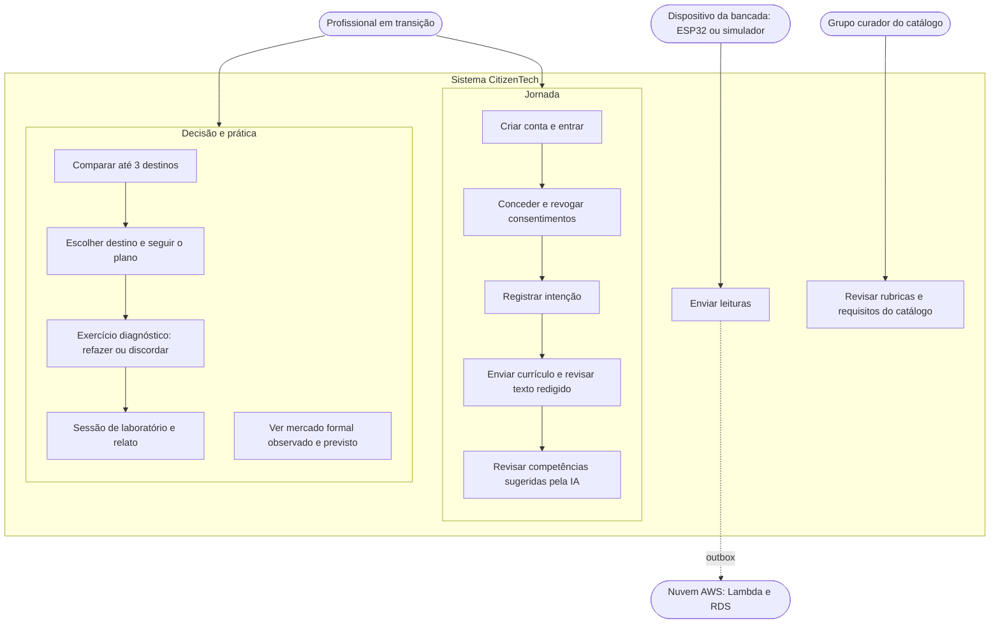
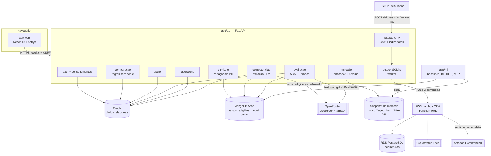
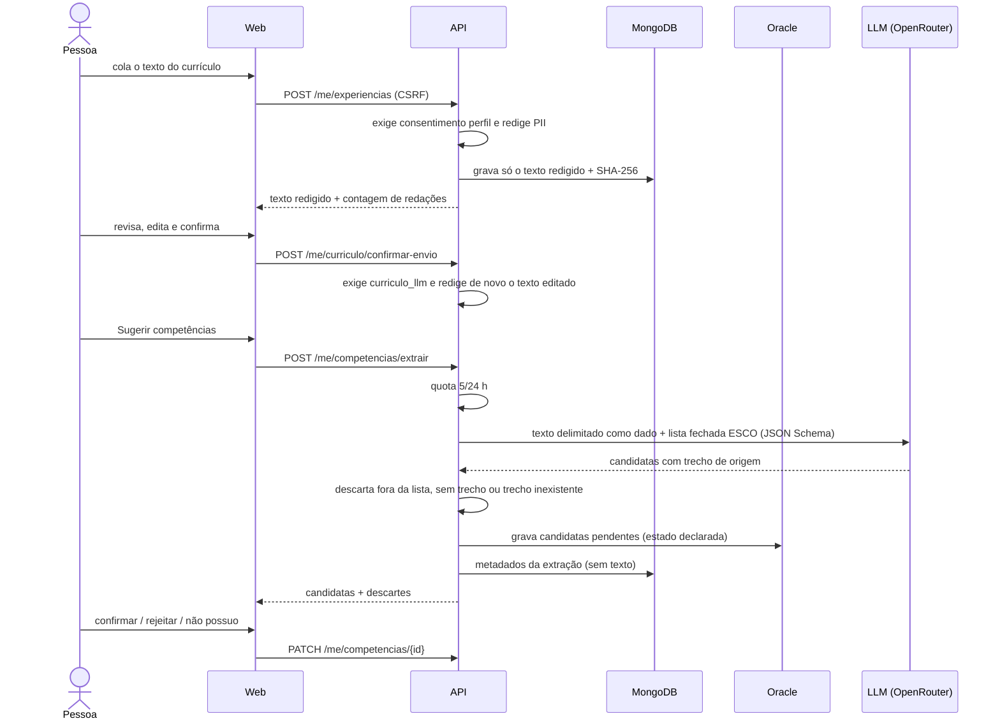
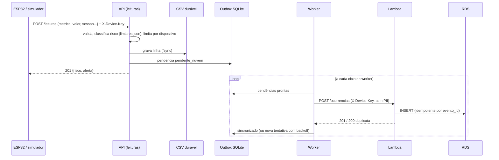
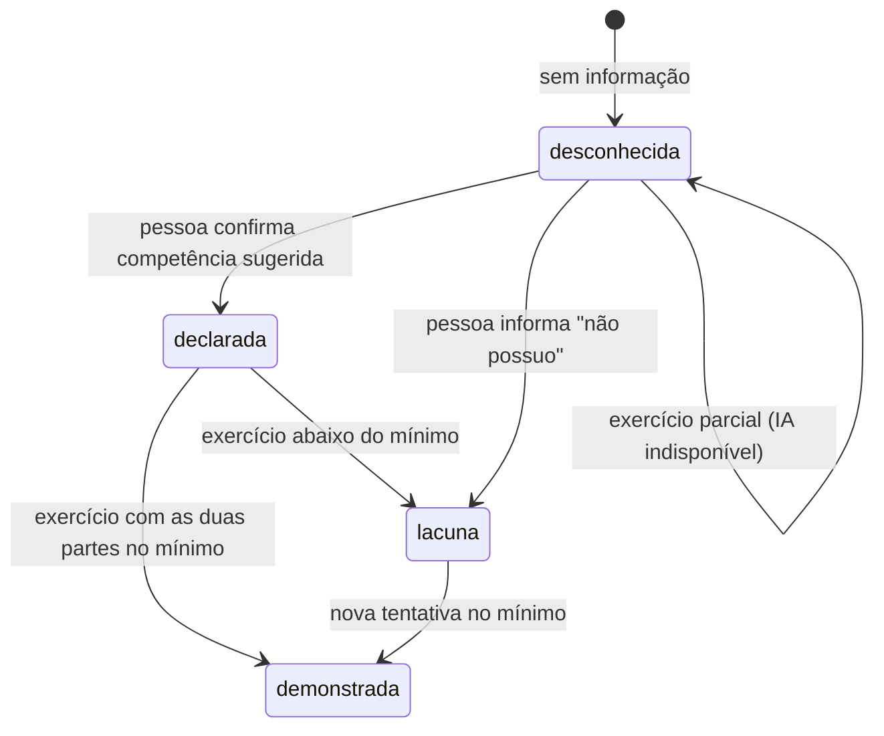
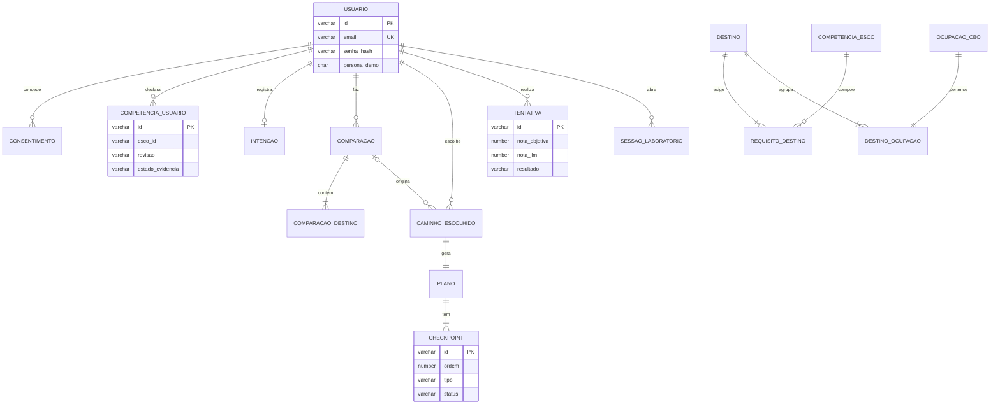

# CitizenTech — modelos UML da solução

> Diagramas em Mermaid (o GitHub os renderiza). As imagens em `docs/uml/img/` são geradas a partir deste arquivo por `app/tools/renderizar_mermaid.py`. Os diagramas descrevem o que está **implementado** em `main`; o que é evolução futura aparece marcado como tal.

## 1. Casos de uso

## 2. Componentes

## 3. Sequência — currículo até competências (D22, T15)

## 4. Sequência — leitura de sensor até a nuvem (S2, S3, S4)

## 5. Estados de um requisito na comparação (D07, T07)

## 6. Modelo de dados relacional (Oracle, DDL 001–007)

**Evolução futura (não implementada):** tabelas `mercado_mensal` e `fontes` no Oracle (hoje o mercado vem do snapshot versionado com hash), exclusão de conta pela API, MFA.
